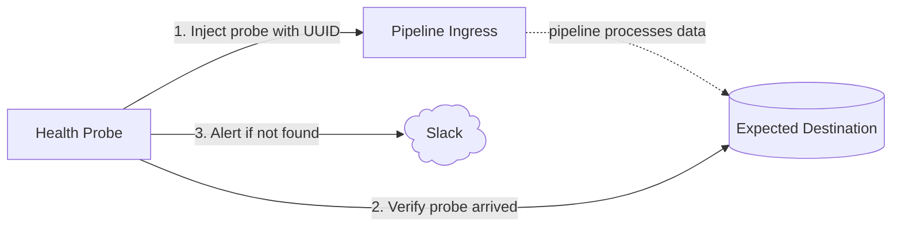

# reops-health-probe

Deno service that continuously runs probes against data pipelines and exposes results as Prometheus metrics. Sends Slack alerts on failure and recovery.

## How it works



Each probe injects a uniquely identifiable event, waits for the pipeline to process it, then queries the destination to confirm it arrived. Alerts via Slack on failure — and again when it recovers.

## Probes

### `innblikk-pipeline`

Tests the Innblikk → BigQuery pipeline. Sends an event via the Innblikk proxy and verifies it appears in BigQuery within 10 minutes.

Runs every 12 minutes via `Deno.cron`.

## Metrics

Exposed at `:9091/metrics` in Prometheus text format.

| Metric | Type | Description |
|---|---|---|
| `probe_success` | gauge | `1` if last run succeeded, `0` if failed |
| `probe_duration_seconds` | gauge | Duration of last probe run |
| `probe_ingress_status_code` | gauge | HTTP status from ingress on last run |
| `probe_last_run_timestamp_seconds` | gauge | Unix timestamp of last run |

All metrics carry a `probe` label with the probe name.

## Configuration

Only one environment variable is required — probe-specific config lives in the probe source itself.

```bash
# Slack alerting (required for alerts)
# Webhook URL — manage at https://api.slack.com/apps/A0B69D3JSQN
SLACK_WEBHOOK_URL=https://hooks.slack.com/services/...

# Environment label shown in Slack alerts and on the dashboard UI (optional, recommended)
# Valid values: dev, development, prod, production — or any custom string
ENVIRONMENT=dev
```

Alerts use Slack Block Kit for rich formatting. Alerts fire only on state **transitions** (ok→fail, fail→ok). After 2 ok→fail transitions within 1 hour, further failure alerts are throttled and a single notice is posted instead. Throttle resets on recovery.

Probe targets (URLs, project IDs, table names) are hardcoded in each probe file. To change them, edit the probe directly.

## Development

Requires [Deno](https://deno.land/) v2+.

```bash
# Run with auto-reload
deno task dev

# Type-check
deno task check
```

## Deployment

Docker image built from `Dockerfile`. BigQuery access uses a service account key stored as a NAIS secret.

```bash
docker build -t reops-health-probe .
docker run --env-file .env reops-health-probe
```

## GCP service account setup

> TODO: move to Terraform

BigQuery access is handled via a service account key injected as `GOOGLE_APPLICATION_CREDENTIALS_JSON` in the NAIS secret `reops-health-probe`.

```bash
# Create the service account
gcloud iam service-accounts create reops-health-probe \
  --project=team-researchops-dev-4396 \
  --display-name="reops-health-probe"

# Grant read access to BQ tables
gcloud projects add-iam-policy-binding team-researchops-dev-4396 \
  --member="serviceAccount:reops-health-probe@team-researchops-dev-4396.iam.gserviceaccount.com" \
  --role="roles/bigquery.dataViewer" \
  --condition=None

# Grant permission to run BQ jobs (required for queries)
gcloud projects add-iam-policy-binding team-researchops-dev-4396 \
  --member="serviceAccount:reops-health-probe@team-researchops-dev-4396.iam.gserviceaccount.com" \
  --role="roles/bigquery.jobUser" \
  --condition=None

# Download key — store the contents as GOOGLE_APPLICATION_CREDENTIALS_JSON in the NAIS secret
gcloud iam service-accounts keys create reops-health-probe-key.json \
  --iam-account=reops-health-probe@team-researchops-dev-4396.iam.gserviceaccount.com
```

## Adding a probe

1. Create `src/probes/<name>.ts` exporting a `Probe` object. Hardcode all probe-specific config (URLs, project IDs, etc.) directly in the file:

```ts
import type { Probe } from "../lib/runner.ts";

export const myProbe: Probe = {
  name: "my-probe",
  async run() {
    // inject something, wait, verify
    return { ok: true, durationMs: 0, ingressStatusCode: 200 };
  },
};
```

2. Register it in `src/main.ts`:

```ts
import { myProbe } from "./probes/my-probe.ts";

registerProbe(myProbe.name);
Deno.cron("probe:my-probe", { minute: { every: 5 } }, () => runProbe(myProbe));
```
