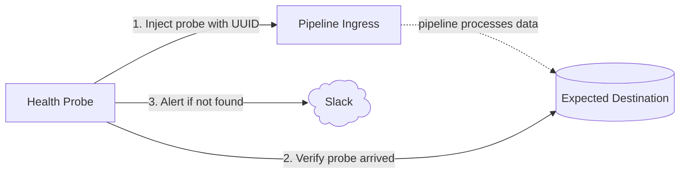

# reops-health-probe

Deno service that continuously runs probes against data pipelines and exposes results as Prometheus metrics. Sends Slack alerts on failure and recovery.

## How it works



Each probe injects a uniquely identifiable event, waits for the pipeline to process it, then queries the destination to confirm it arrived. Alerts via Slack on failure — and again when it recovers.

## Probes

### `innblikk-pipeline`

Tests the Innblikk → BigQuery pipeline. Sends an event via the Innblikk proxy and verifies it appears in BigQuery within 10 minutes.

Runs every 12 minutes via `Deno.cron`.

## Metrics

Exposed at `:9091/metrics` in Prometheus text format.

| Metric | Type | Description |
|---|---|---|
| `probe_success` | gauge | `1` if last run succeeded, `0` if failed |
| `probe_duration_seconds` | gauge | Duration of last probe run |
| `probe_ingress_status_code` | gauge | HTTP status from ingress on last run |
| `probe_last_run_timestamp_seconds` | gauge | Unix timestamp of last run |

All metrics carry a `probe` label with the probe name.

## Configuration

Environment variables (create a `.env` file locally):

```bash
# Innblikk proxy
INGRESS_URL=https://reops-event-proxy.ekstern.dev.nav.no
WEBSITE_ID=your-website-id

# BigQuery dataset/table (defaults to innblikk pipeline values)
BQ_PROJECT=team-researchops-prod-01d6
BQ_DATASET=umami_custom
BQ_TABLE=public_website_event

# Slack
SLACK_WEBHOOK_URL=https://hooks.slack.com/services/...
```

## Development

Requires [Deno](https://deno.land/) v2+.

```bash
# Run with auto-reload
deno task dev

# Type-check
deno task check
```

## Deployment

Docker image built from `Dockerfile`. Uses GCP Workload Identity for BigQuery access — no service account keys needed.

```bash
docker build -t reops-health-probe .
docker run --env-file .env reops-health-probe
```

## Adding a probe

1. Create `src/probes/<name>.ts` exporting a `Probe` object:

```ts
import type { Probe } from "../lib/runner.ts";

export const myProbe: Probe = {
  name: "my-probe",
  async run() {
    // inject something, wait, verify
    return { ok: true, durationMs: 0, ingressStatusCode: 200 };
  },
};
```

2. Register it in `src/main.ts`:

```ts
import { myProbe } from "./probes/my-probe.ts";

Deno.cron("probe:my-probe", { minute: { every: 5 } }, () => runProbe(myProbe));
```
