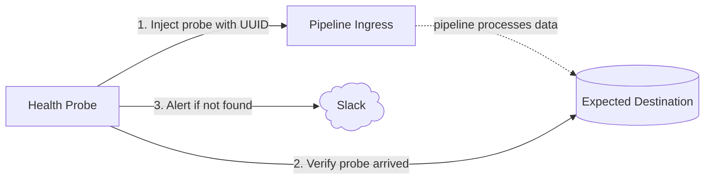

# reops-health-probe

Next.js service that continuously runs probes against data pipelines and exposes results as Prometheus metrics. Sends Slack alerts when delivery cannot be confirmed and when subsequent checks succeed.

## How it works



Each probe injects a uniquely identifiable event, waits for the pipeline to process it, then queries the destination to confirm it arrived. Slack alerts distinguish repeated unconfirmed checks from intermittent QoS concerns. An event not observed before verification ends may still arrive later; this does not prove event loss.

## Probes

### `innblikk-pipeline`

Tests the Innblikk → BigQuery pipeline. Sends an event via the Innblikk proxy and verifies it appears in BigQuery.

## Metrics

Exposed at `:9091/metrics` in Prometheus text format.

| Metric | Type | Description |
|---|---|---|
| `probe_success` | gauge | `1` if last run succeeded, `0` if failed |
| `probe_success_rate` | gauge | Running average of successful runs over full history (0.0–1.0) |
| `probe_duration_seconds` | gauge | Duration of last probe run |
| `probe_last_run_timestamp_seconds` | gauge | Unix timestamp of last run |

All metrics carry a `probe` label with the probe name.

## Configuration

Only one environment variable is required — probe-specific config lives in the probe source itself. `ENVIRONMENT` is set via the NAIS manifest and does not need to be in the secret.

```bash
# Slack alerting (required for alerts)
# Webhook URL — manage at https://api.slack.com/apps/A0B69D3JSQN
SLACK_WEBHOOK_URL=https://hooks.slack.com/services/...
```

Alerts use Slack Block Kit for rich formatting:

- **Hard alert:** 3 consecutive checks unable to confirm delivery trigger an immediate alert, 24/7. A successful check sends a follow-up; this does not mean earlier unconfirmed events have been rechecked. Existing hard-alert throttling is unchanged.
- **Soft warning — “Possible pipeline QoS degradation”:** at least 3 unconfirmed checks within the last 100 completed probes, even if successful checks occur between them. The window can contain fewer than 100 results during startup. Not observing an event in BigQuery within the probe's verification window does not confirm event loss: it may still arrive later. Warnings include the observation detail from the check that crossed the threshold, including the configured polling wait when BigQuery verification times out. Ingress/query errors also count as unconfirmed checks, with their actual error detail rather than a timeout claim.
- Soft warnings are delivered only **Monday–Friday, 09:00–16:30 Europe/Oslo** (DST-aware; no public-holiday calendar). Outside these hours, warnings wait until the next working period. Delivery is checked every 30 seconds, even while probes are paused. If the threshold clears before delivery, the message reports that it is no longer met rather than implying an ongoing problem.
- One soft warning per threshold crossing; rearmed once unconfirmed checks drop below 3 in the rolling window. Undelivered warnings are combined. Hard alerts cancel queued soft warnings and reset the soft window, avoiding duplicate notifications for the same incident. Soft warnings do not send recovery notifications or affect hard-alert throttling.

The soft threshold and window size are defined in `src/lib/alert-policy.ts`. Windows use completion order, not elapsed time; paused/aborted runs do not count. Alert state and queued warnings are in memory and reset on process restart. Failed soft-warning deliveries are retried during working hours.

Probe targets (URLs, project IDs, table names) are hardcoded in each probe file. To change them, edit the probe directly.

## Development

Requires [Node.js](https://nodejs.org/) and [pnpm](https://pnpm.io/).

```bash
# Run with auto-reload
pnpm dev

# Type-check
pnpm check

# Alert policy and runner tests (no external services)
pnpm test
```

## Deployment

Docker image built from `Dockerfile`. BigQuery access uses a service account key stored as a NAIS secret.

```bash
docker build -t reops-health-probe .
docker run --env-file .env reops-health-probe
```

## GCP service account setup

> TODO: move to Terraform

BigQuery access is handled via a service account key injected as `GOOGLE_APPLICATION_CREDENTIALS_JSON` in the NAIS secret `reops-health-probe`.

```bash
# Create the service account
gcloud iam service-accounts create reops-health-probe \
  --project=team-researchops-dev-4396 \
  --display-name="reops-health-probe"

# Grant read access to BQ tables
gcloud projects add-iam-policy-binding team-researchops-dev-4396 \
  --member="serviceAccount:reops-health-probe@team-researchops-dev-4396.iam.gserviceaccount.com" \
  --role="roles/bigquery.dataViewer" \
  --condition=None

# Grant permission to run BQ jobs (required for queries)
gcloud projects add-iam-policy-binding team-researchops-dev-4396 \
  --member="serviceAccount:reops-health-probe@team-researchops-dev-4396.iam.gserviceaccount.com" \
  --role="roles/bigquery.jobUser" \
  --condition=None

# Download key — store the contents as GOOGLE_APPLICATION_CREDENTIALS_JSON in the NAIS secret
gcloud iam service-accounts keys create reops-health-probe-key.json \
  --iam-account=reops-health-probe@team-researchops-dev-4396.iam.gserviceaccount.com
```

## Why not Gatus?

[Gatus](https://github.com/TwiN/gatus) is a solid open-source health-checking tool and worth considering for simpler setups. We evaluated it, but it didn't fit our needs.

Gatus probes are defined in YAML config: each probe is a single HTTP request to a fixed endpoint, with basic assertions on the response (status code, body contains a string, etc.). That covers a lot of common use cases well.

Our pipelines require something more involved. A typical probe here looks like:

1. Send a request to endpoint A with a generated UUID payload
2. Wait several minutes for the pipeline to process it
3. Query a completely different system (e.g. BigQuery) to verify the UUID arrived
4. Parse the response and assert on specific field values
5. Report success or failure — with full request/response detail for debugging

There's no way to express that kind of multi-step, stateful, cross-system logic in Gatus's config format. A probe here is just a TypeScript async function — it can do anything, call anything, wait arbitrarily, and return structured results. That flexibility is the whole point.

Gatus may be a good fit if we ever add simple uptime checks (is this endpoint reachable? does it return 200?). For pipeline integrity probes, we need code.

## Adding a probe

1. Create `src/probes/<name>.ts` exporting a `Probe` object. Hardcode all probe-specific config (URLs, project IDs, etc.) directly in the file:

```ts
import type { Probe } from "../lib/runner";

export const myProbe: Probe = {
  name: "my-probe",
  schedule: { type: "interval", ms: 5 * 60 * 1000 },
  async run() {
    // inject something, wait, verify
    return { ok: true, durationMs: 0 };
  },
};
```

2. Add it to the `probes` array in `server.ts`:

```ts
import { myProbe } from "./src/probes/my-probe";

const probes = [innblikkPipelineProbe, myProbe];
```

## License

This project is licensed under the [MIT License](LICENSE).
