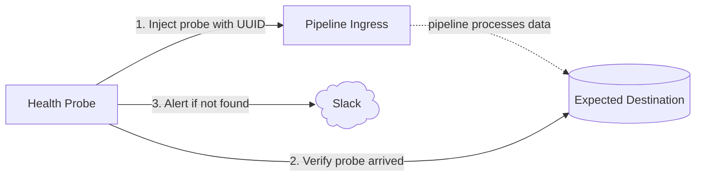

# reops-health-probe

Next.js service that continuously runs probes against data pipelines and exposes results as Prometheus metrics. Sends Slack alerts on failure and recovery.

## How it works



Each probe injects a uniquely identifiable event, waits for the pipeline to process it, then queries the destination to confirm it arrived. Alerts via Slack on failure — and again when it recovers.

## Probes

### `innblikk-pipeline`

Tests the Innblikk → BigQuery pipeline. Sends an event via the Innblikk proxy and verifies it appears in BigQuery.

## Metrics

Exposed at `:9091/metrics` in Prometheus text format.

| Metric | Type | Description |
|---|---|---|
| `probe_success` | gauge | `1` if last run succeeded, `0` if failed |
| `probe_success_rate` | gauge | Running average of successful runs over full history (0.0–1.0) |
| `probe_duration_seconds` | gauge | Duration of last probe run |
| `probe_last_run_timestamp_seconds` | gauge | Unix timestamp of last run |

All metrics carry a `probe` label with the probe name.

## Configuration

Only one environment variable is required — probe-specific config lives in the probe source itself.

```bash
# Slack alerting (required for alerts)
# Webhook URL — manage at https://api.slack.com/apps/A0B69D3JSQN
SLACK_WEBHOOK_URL=https://hooks.slack.com/services/...

# Environment label shown in Slack alerts and on the dashboard UI (optional, recommended)
# Valid values: dev, development, prod, production — or any custom string
ENVIRONMENT=dev
```

Alerts use Slack Block Kit for rich formatting. Alerts fire only on state **transitions** (ok→fail, fail→ok). Failure alerts require 3 consecutive failures before firing. Throttle resets on recovery.

Probe targets (URLs, project IDs, table names) are hardcoded in each probe file. To change them, edit the probe directly.

## Development

Requires [Node.js](https://nodejs.org/) and [pnpm](https://pnpm.io/).

```bash
# Run with auto-reload
pnpm dev

# Type-check
pnpm check
```

## Deployment

Docker image built from `Dockerfile`. BigQuery access uses a service account key stored as a NAIS secret.

```bash
docker build -t reops-health-probe .
docker run --env-file .env reops-health-probe
```

## GCP service account setup

> TODO: move to Terraform

BigQuery access is handled via a service account key injected as `GOOGLE_APPLICATION_CREDENTIALS_JSON` in the NAIS secret `reops-health-probe`.

```bash
# Create the service account
gcloud iam service-accounts create reops-health-probe \
  --project=team-researchops-dev-4396 \
  --display-name="reops-health-probe"

# Grant read access to BQ tables
gcloud projects add-iam-policy-binding team-researchops-dev-4396 \
  --member="serviceAccount:reops-health-probe@team-researchops-dev-4396.iam.gserviceaccount.com" \
  --role="roles/bigquery.dataViewer" \
  --condition=None

# Grant permission to run BQ jobs (required for queries)
gcloud projects add-iam-policy-binding team-researchops-dev-4396 \
  --member="serviceAccount:reops-health-probe@team-researchops-dev-4396.iam.gserviceaccount.com" \
  --role="roles/bigquery.jobUser" \
  --condition=None

# Download key — store the contents as GOOGLE_APPLICATION_CREDENTIALS_JSON in the NAIS secret
gcloud iam service-accounts keys create reops-health-probe-key.json \
  --iam-account=reops-health-probe@team-researchops-dev-4396.iam.gserviceaccount.com
```

## Why not Gatus?

[Gatus](https://github.com/TwiN/gatus) is a solid open-source health-checking tool and worth considering for simpler setups. We evaluated it, but it didn't fit our needs.

Gatus probes are defined in YAML config: each probe is a single HTTP request to a fixed endpoint, with basic assertions on the response (status code, body contains a string, etc.). That covers a lot of common use cases well.

Our pipelines require something more involved. A typical probe here looks like:

1. Send a request to endpoint A with a generated UUID payload
2. Wait several minutes for the pipeline to process it
3. Query a completely different system (e.g. BigQuery) to verify the UUID arrived
4. Parse the response and assert on specific field values
5. Report success or failure — with full request/response detail for debugging

There's no way to express that kind of multi-step, stateful, cross-system logic in Gatus's config format. A probe here is just a TypeScript async function — it can do anything, call anything, wait arbitrarily, and return structured results. That flexibility is the whole point.

Gatus may be a good fit if we ever add simple uptime checks (is this endpoint reachable? does it return 200?). For pipeline integrity probes, we need code.

## Adding a probe

1. Create `src/probes/<name>.ts` exporting a `Probe` object. Hardcode all probe-specific config (URLs, project IDs, etc.) directly in the file:

```ts
import type { Probe } from "../lib/runner";

export const myProbe: Probe = {
  name: "my-probe",
  schedule: { type: "interval", ms: 5 * 60 * 1000 },
  async run() {
    // inject something, wait, verify
    return { ok: true, durationMs: 0 };
  },
};
```

2. Add it to the `probes` array in `server.ts`:

```ts
import { myProbe } from "./src/probes/my-probe";

const probes = [innblikkPipelineProbe, myProbe];
```
